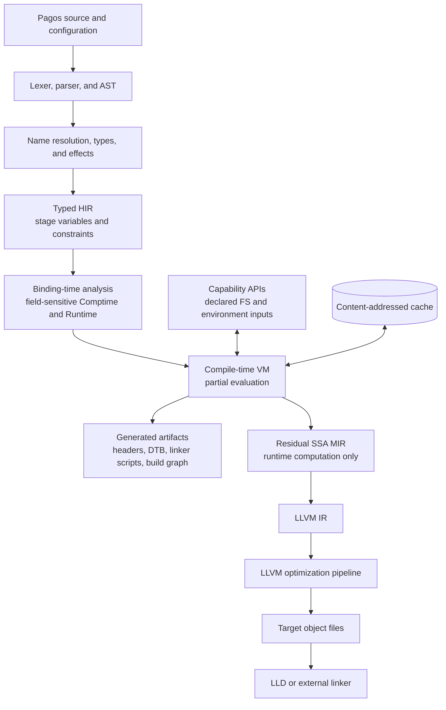

# Compiler Architecture

Status: Milestones 1 and 2 core baselines implemented; see the
[Milestone 2 summary](milestone-2.md) for scope and deferred work. The broader
component design below also includes future systems and build capabilities.

## Design boundary

LLVM is responsible for optimizing and generating the residual runtime program.
It is not responsible for Pagos binding-time inference, effect checking,
compile-time execution, or stage diagnostics.

Pagos-specific semantics must be resolved before lowering to LLVM IR.

## Milestone 1 implementation baseline

The reference compiler uses C++26, CMake, and LLVM 22. Its populated modules
mirror the repository layout: source management, syntax, semantic typing, typed
HIR, stage analysis, the compile-time evaluator, and LLVM code generation are
separate libraries. The AST contains syntax and spans only; an independent type
table feeds stage analysis.

Milestone 1 initially lowered residual typed HIR directly to LLVM IR as a
vertical-slice shortcut. The first Milestone 2 slice replaces that shortcut
with the residual SSA MIR boundary shown below. No LLVM IR types or values
appear in syntax, semantic, HIR, evaluator, or MIR interfaces. The private
integer implementation may use LLVM Support/ADT (`APInt`); binding-time rules,
checked-operation diagnostics, and target semantics remain Pagos-owned.

M3 preparation separates source annotations (`syntax::Type`) from semantic
facts (`sema::Type`) and concrete residual descriptors (`mir::Type`). Semantic
and MIR integers carry width/signedness and `usize` identity; arrays carry a
scalar element type and length, and record fields retain ordered types plus
nominal identity.
Deferred semantic lengths and error/unknown types cannot become valid MIR.
Source syntax admits the M2 subset plus signed/unsigned widths 8/16/32/64 and
explicit integer conversions, plus target-sized unsigned `usize`.
Source annotations and suffixes keep `usize` unresolved. The semantic type
table owns the session's pointer width and resolves annotations explicitly;
staging consumes the same table. It never mutates syntax or uses host `sizeof`.
LLVM integer types erase signedness, so code generation retains the
verified MIR definition's signedness for comparisons, division, right shift,
and extension. Checked signed division/remainder guard both zero and MIN/-1.

`IntegerValue` stores up to 64 bits inline and delegates checked arithmetic
to a private APInt adapter. Wider values are rejected explicitly. Scalar,
array, and record integer payloads all use this canonical representation,
including width, signedness, and `usize` identity in specialization keys.
Shared equality, hashing, scalar
conversion, and printing preserve nominal record identity and scalar types.

HIR nodes are shared immutable computations, but their `Constant` payloads
are currently owned values. Specialization keys copy argument payloads;
Sequence construction and HIR-to-MIR constant emission can also copy vectors.
No constant pool, shared aggregate payload, or arena migration is introduced
without a measured benefit. This is an explicit remaining optimization point,
not a claim of zero-copy evaluation.

`codegen::TargetConfig` carries the triple, CPU, and feature string for each
compilation session. The CLI resolves it once before semantic analysis, for
all commands, and reuses it for emission. HIR/MIR retain the semantic pointer
width, even after target-dependent expressions fold away; MIR verification,
layout queries, and emission reject inconsistent `usize` widths. Unbound
hand-built modules may contain fixed-width types, but not `usize`.
MIR dumps expose `pointer_bits` and `usize32`/`usize64`; source/HIR spell `usize`.
`TargetLayout` obtains DataLayout from LLVM TargetMachine
and queries pointer width, allocation size, ABI alignment, and record field
offsets. Layout and LLVM emission share one private storage-type conversion.
No target-specific layout cache is global, and board MMIO addresses remain
outside the compiler. A storage layout is not a C ABI argument/return
classification; only the explicit minimal C ABI below is currently supported.



## Components

### 1. Source manager and diagnostics

Own source buffers, stable spans, line maps, macro/generated-source provenance,
and structured diagnostics. Stage dependency paths must retain source locations
through every IR.

### 2. Lexer and parser

Begin with a hand-written lexer and recursive-descent/precedence parser. The
grammar should remain intentionally small until staging behavior is proven.

The AST represents syntax only. It should not own symbol resolution, inferred
types, or LLVM values.

### 3. Semantic analysis

Perform:

- module and name resolution;
- type checking and inference;
- effect checking;
- construction of generic constraints;
- collection of explicit `comptime` and `runtime` constraints.

Do not emit LLVM IR from the AST.

### 4. Typed HIR

HIR preserves source-level structure while making types, symbols, effects, and
stage variables explicit. It is the main representation for high-quality
language diagnostics.

Important HIR concepts include:

- stage variables and constraints;
- effect sets;
- typed aggregate fields;
- function calls before specialization;
- explicit runtime roots;
- structured Runtime ranges and residual sequencing;
- compile-time capability operations.

The current scalar/array HIR is a shared expression graph. `Reference` nodes
attach use-specific diagnostic paths without cloning the referenced computation;
loop indices and Runtime reads keep their original identity through aliases
and calls. `Sequence` records ordered residual evaluations plus a result whose
value stage may still be Comptime. Statement and argument evaluations are
retained even when their values are unused. MIR reuses an already lowered
value only where its definition dominates the use. `emit-hir` includes a
`residual =` line for sequenced entry work, including top-level loops; repeated
textual expressions can denote shared nodes rather than repeated evaluations.

Comptime-index array projection follows `Reference` nodes and the result of a
`Sequence` to an `Array` construction. It selects that element's stage and
rebases diagnostic alias/parameter steps onto that element's Runtime source.
Folding emits a `Sequence` of the original array/index work and a fresh scalar
constant, preserving identity and all earlier evaluations. Explicit
`RuntimeBoundary`, Runtime `If`, and `ReturnScope` nodes are opaque: projection
does not infer Comptime values across Runtime selection or compare branches.

HIR records whether an expression can continue and whether it may return from
the enclosing call. `Return` carries the return value; `ReturnScope` delimits
the return boundary of a specialized body, inline or outlined. Comptime returns
disappear during analysis. MIR lowering routes residual returns to a per-call
exit and merges their values with a phi. Terminated paths contribute neither an `if`
continuation nor a loop backedge. The type side table uses an internal `never`
type for expressions that always return, so they need no continuation value.

### 5. Binding-time analysis

Solve the `Comptime <= Runtime` constraints, preserving field and value
precision. Record explanation edges so every Runtime result can identify its
origin and every failed `comptime` requirement can show a thaw path.

This phase determines which regions are executable by the compile-time VM and
which require symbolic/residual values.

The current analyzer additionally builds a
[Provenance snapshot](provenance-analysis.md). A task-owned Builder records
evidence without feeding queries back into staging. Freezing transfers storage
into a shared immutable graph attached to the HIR module; query scratch and
call contexts belong to each query. Existing RuntimeTrace diagnostics remain
in place while the new representation is validated.

Explicit Runtime boundaries, selections, member projections and conservative
recursive completion now submit semantic events at their Stage decision points.
The snapshot owns sparse `StageDecision` entries independently of graph storage
rules. Inline instantiation and local contract substitution preserve these
entries while rebinding dependencies. Missing events for migrated HIR kinds are
consistency errors; the Recorder does not reconstruct their Stage reasons.

### 6. Compile-time VM and partial evaluator

The first implementation should use a tree/bytecode interpreter rather than
LLVM JIT. Priorities are:

- deterministic behavior;
- precise source-level stack traces;
- configurable fuel and memory limits;
- target-correct scalar semantics;
- capability enforcement;
- dependency recording;
- symbolic values for residualization.

ORC JIT can later accelerate pure, closed, frequently evaluated functions. It
must not become the semantic reference implementation.

The evaluator produces both concrete Comptime values and residual operations.
Comptime values crossing the boundary are checked for embeddability.

The current evaluator supports bounded Comptime recursion and memoizes pure,
fully Comptime results. `AnalysisLimits` controls fuel, recursion depth, and the
number of Comptime specializations and, separately, completed scalar residual
definitions. `AnalysisStats` exposes both counts and cache-hit counters, along
with consumption and maximum analysis depth. Scalar Runtime recursion reuses
active signatures. Full host-memory accounting remains future work.

Array generators retain bound expressions in compact AST nodes through type
checking, without per-element AST expansion. The semantic type table retains
literal lengths where known and uses length zero for deferred scalar-array
shapes (`[u32; ?]` / `[bool; ?]` in diagnostic text). Zero is not a valid source
array length or a MIR value type. Analysis evaluates the bounds per invocation
and creates concrete HIR types without mutating the shared semantic table.
It rechecks deferred shape constraints at bindings, call arguments, explicit
returns, function tails, and Runtime branch joins before MIR lowering.
Source signatures remain fixed-length, not dependent types.

After bound evaluation, analysis reserves cumulative quotas before allocating the
element vector, then charges fuel per iteration and analyzes the scoped body.
Bound effects wrap the constructed result in a Sequence, preserving early exits,
reads, traps, and argument work on cache hits. Bound evaluation itself uses the
ordinary fuel, recursion, specialization, and construction budgets.
Both generators and literals use the same HIR array construction path, so
embedding, per-element staging, effects, and residual returns remain shared.
Quota checks use remaining capacity and division before multiplication to
avoid overflow; counters reset for each analysis. These quotas do not measure
HIR overhead, cache copies, or backend allocations.

The CRC-32 demonstration exercises this path with recursive Comptime table
construction and residual checked lookups. `u32` bitwise operators preserve
the same stages and sequencing as other strict primitives. MIR names shifts
`shl.checked` / `lshr.checked`; LLVM lowering guards Runtime counts before
shifting to avoid poison. Right shift is logical, and no overflow/exact flags
are attached. Known valid counts need no residual guard. See the
[CRC walkthrough](crc32.md) for the differential test and current scope.

Minimal record declarations retain only source names and explicit scalar types
in AST. Inferred expression types remain in semantic side tables. HIR carries
record schemas and canonical declaration-order field operands; a Sequence
preserves source-order initializer work, with shared identities preventing
duplicate execution. Field projection looks through aliases and sequences,
but not Runtime boundaries, conditionals, or call return joins. Portable
constants in `include/pagos/value.h` carry nominal record names and typed
scalar fields; specialization keys hash their contents, not host pointers.

Shared aggregate reservations count scalar members and logical payload bytes
for arrays and records. Remaining-capacity checks precede sums/products and
member-vector allocation. Records count declared boolean and integer fields;
array checks compose atomically with existing array-only quotas. An exhausted
construction budget suppresses subsequent construction-budget errors until the
next analysis. Statistics count successful reservations, including ones whose
evaluation later exits early, not live heap allocations. Constant/key copies,
record schema storage, and backend allocations remain outside these quotas.

### 7. Residual SSA MIR

MIR contains only target-runtime work. It should be small, typed, target-aware,
and convenient to verify and lower.

The current MIR has explicit basic blocks, SSA values, typed operations,
conditional and unconditional branches, phi nodes, range-loop backedges,
checked division, remainder, array construction and indexing, and returns.
Array types carry scalar element kind and fixed length; constants and
specialization keys contain array values, never host addresses. The verifier
checks array lengths, element types, index types, and operand dominance.
LLVM lowers known tables to deduplicated private read-only globals. Dynamic
array values use SSA aggregates; dynamic indexing uses entry-block storage
reused across loop iterations. Bounds checks precede address calculation and
loads; failure calls `llvm.trap`. MIR verification also rejects invalid
types, undefined values, unreachable blocks, incomplete phi inputs, and
non-dominating uses before LLVM lowering. `pagosc emit-mir` provides a stable
textual form for golden tests.

Record construction and constant-field projection are explicit MIR operations.
Nominal record types include ordered scalar field kinds; verification rejects
inconsistent definitions, malformed constants, wrong field types/counts,
out-of-range projections, non-dominating operands, and incompatible phi inputs.
LLVM uses unpacked struct values with `insertvalue`, `extractvalue`, and struct
phis. This internal representation is not a source-level layout or C ABI
contract. Record values do not require heap allocation.

Initial operations should cover:

- constants and arithmetic;
- blocks, branches, and phi/block parameters;
- function calls and returns;
- stack/global storage;
- loads, stores, and volatile operations;
- address calculation;
- embedded constants and symbol relocations.

MIR is also the right level for Pagos-specific size reports and simple cleanup
passes before LLVM lowering.

### 8. LLVM backend

Lower MIR to LLVM IR with an explicit target triple, data layout, CPU, and
features. Use LLVM's supported optimization pipeline and target machine APIs to
produce assembly or object files.

Pin one tested LLVM release series in CI. Do not depend on LLVM trunk APIs for
the initial compiler.

LLD may be embedded or invoked as an external linker. Supporting an external
linker first keeps the compiler smaller and works better with vendor toolchains.

### 9. Artifact generation

Configuration libraries should produce typed intermediate data first, followed
by explicit emitters for formats such as:

- C headers and source files;
- static device initialization tables;
- linker scripts and memory maps;
- DTS/DTB and Zephyr overlays;
- Kconfig fragments when integrating with existing projects;
- Ninja-compatible build graphs.

Artifact generation is not LLVM code generation and should remain a separate
library layer.

### 10. Build graph executor

Compile-time Pagos code constructs a declarative graph of commands, files,
tools, environments, and outputs. A separate executor schedules actions and
maintains a content-addressed cache.

This prevents arbitrary command execution from contaminating language
evaluation and makes build dependencies inspectable.

## Recommended repository layout

```text
pagos/
  CMakeLists.txt
  docs/
  include/pagos/
    source/
    syntax/
    sema/
    hir/
    stage/
    vm/
    mir/
    codegen/
  lib/
    source/
    syntax/
    sema/
    hir/
    stage/
    vm/
    mir/
    codegen/
  tools/
    pagosc/
  runtime/
    core/
  std/
    core/
    build/
    embedded/
  tests/
    syntax/
    sema/
    stage/
    vm/
    mir/
    codegen/
    integration/
```

This is a target layout, not a request to create empty directories before they
have code.

## Interoperability strategy

### Runtime calls and effect migration

Scalar-argument calls with Runtime scalar results retain an HIR `Call` and
share an immutable `ResidualFunction` containing generic `Parameter` nodes.
The staging key includes source identity, typed Comptime values, and Runtime
positions/types; session-local caches cannot cross semantic target layouts.
Caller-side sequencing retains all argument work, while only Runtime values
are passed to parameters. Comptime values with effects are embedded as pure
constants after preserving their effects in the caller. Each call remains a
distinct HIR computation identity. Lowering interns definition identities into
module-local symbols, with a separate SSA/dominance cache and return scopes
per function. Aggregate calls retain their inline path and projection precision.
Non-recursive scalar Comptime-result bodies are instantiated back into the caller
with a DAG-preserving parameter substitution, not forced into Runtime calls.

Parameter traces carry symbolic IDs. Invocation substitutes current argument
provenance, and diagnostics during analysis resolve active parameter chains.
Completed Runtime definitions enter the reusable cache; a separate active-key
map exposes provisional typed signatures for direct and mutual recursion.
Recursive edges reserve version slots and conservatively return Runtime, without
requiring a completed body summary. Failed analyses clear the reusable residual
cache because nested definitions may refer back to the failed body. Other
independent diagnostics still run. Hits skip body analysis but still analyze and
evaluate arguments. Version quotas include active recursive reservations and
completed definitions, not call sites, emitted bytes, or peak memory.

The HIR module owns residual definitions; call edges hold weak references so
recursive components do not leak through shared ownership cycles. Definitions
outlive the analyzer when their module does. MIR reserves each symbol before
lowering its body, and LLVM predeclares all signatures. HIR printing lists
recursive bodies separately and prints backreferences without expanding cycles.

`mir::Function` has typed parameters and internal linkage; `ParameterOperation`
and `CallOperation` represent parameter values and direct symbol calls.
Module verification resolves forward callees, checks arity, exact argument/
result types (including `usize` identity), parameter indices, and dominance.
LLVM declares all signatures before emitting bodies. Generated symbols use
`pagos.<source-name>.<module-local-id>` and are internal; LLVM may inline them
during optimization. `pagos_main` keeps the existing test entry ABI.

Scalar Runtime recursion is supported, but aggregate recursive signatures
remain separate work. Compilation budgets neither prove termination nor bound target
stack usage. Do not infer aggregate C ABI classification from storage layout
alone.

Ordinary external calls are Runtime and conservatively effectful unless a
separate, explicit compile-time capability exists. A Comptime address never
licenses evaluating, removing, merging, or caching a volatile/MMIO read or
write. Future target addresses must be target-width values or symbolic
relocations, never dereferenceable host pointers. Ordinary raw memory now uses
the contract below; additional address spaces remain future
work. No host execution of target code is introduced.

The current `hir::has_residual_work` and `hir::is_cacheable_result` predicates
are shared entry points: a Comptime result can retain Runtime work, trapping
operations, or return control. Cache hits still evaluate arguments in source
order, including unused arguments, and only pure completed constant results
are memoized. MIR's dominance-aware reuse of the same computation identity
is distinct from proving that two separate effectful operations are equal.
Specialization caches currently reset per analysis; any future cross-session
cache containing target-dependent facts must include target configuration
in its identity. These boundaries precede adding a richer effect model.

The [Cache Architecture RFC](cache-architecture-rfc.md) proposes a shared
semantic-query cache protocol, with separate incremental dependencies and
Stage evidence. Its first experiment targets pure Comptime specialization
results, including closed array generators, while preserving argument work
and the existing session-local budget rules. Stable identities, resource
recipes, and serialization precede residual-template persistence. Filesystem
manifests, a CAS, and sectioned binary evidence snapshots are the default;
an embedded database is optional and requires measured metadata bottlenecks.
The [implementation plan](cache-implementation-plan.md) splits the first
stages into independently verifiable iterations. [C1a](cache-identity-c1a.md)
implements canonical
bool/integer/scalar-array codecs, stable checked-AST fingerprints and source
anchors. The driver supplies a resolved target and compiler compatibility
identity in an immutable `QueryContext`. [C1b](cache-store-c1b.md) adds a
filesystem manifest index and immutable CAS, with atomic publication,
bounded validation, conflict markers,
and crash/concurrency tests. [C2a](cache-scalar-c2a.md) adds experimental pure
scalar reuse after session-local misses, exact budget replay, current source
locations, and separate telemetry. [C2b](cache-array-c2b.md) extends this to fixed scalar arrays and arithmetic
generators, with ordered construction/Fuel templates and off/cold/hot
measurements. [C3a](provenance-snapshot-c3a.md) adds module evidence snapshots
and separate source revisions; [C3b](cache-residual-c3b.md) restores closed scalar
HIR templates with mandatory evidence and budget replay. The cache remains off
by default.

C3q1 adds resumable queries on the memory graph; C3q2 supplies shared dependency
formulas and compressed call topology. C3a now persists the module graph and
restores it fully. [C4a1](provenance-view-c4a1.md) adds pinned memory/disk views
and native block reads. [C4a2](provenance-units-c4a2.md) captures actual
specialization identities and freezes function Imports/SCCs with validated hot
closures/decisions. [C4a3](provenance-function-queries-c4a3.md) maps function
units to lazy query/topology views and an independent-process CLI. Evidence
coverage, query progress, detail availability, and presentation are separate
states. Query slices cannot alter Stage, diagnostics, or logical budgets.
C4b-C4e then cover construction spill, query checkpoints,
finite-domain recursive summaries, and deterministic pure detail replay.
[C4b1](provenance-spill-c4b1.md) now supplies an independent segmented builder
with temporary spill and auxiliary storage failures.
[C4b2](provenance-recorder-spill-c4b2.md) integrates Recorder and explicit CLI,
keeps native views until compatibility restoration is requested, and guards
semantic publication on evidence availability. [C4b3a](provenance-trace-c4b3a.md)
shares immutable RuntimeTrace prefixes; path representation savings are assessed
separately from spill savings. [C4b3b](provenance-working-set-c4b3b.md) adds a
separate definition catalog, retained metadata accounting, working-table release,
lifetime locks and explicit dead-session reclamation. Independent Release runs
confirm build-peak savings for a larger graph; smaller inputs have no stable net
benefit. C4b experimental acceptance is complete; memory remains the default.
[C4c1](provenance-checkpoint-c4c1.md) adds explicitly saved query snapshots bound
to the verified function closure, positions and source revision, with acknowledged
page redelivery across processes. [C4c2a](provenance-task-store-c4c2a.md) adds
segmented snapshots, atomic task heads and explicit paused-state capacity release
with quotas and lifecycle cleanup. [C4c2b](provenance-query-paging-c4c2b.md)
adds opt-in active-query paging, sorted disk indexes and a bounded decoded cache.
Restore streams full validation without materializing all tables; directories,
codec scratch and compatibility results are outside the buffer budget.
[C4c3a](provenance-topology-checkpoint-c4c3a.md) adds disk-backed symbolic
topology/formula preparation with bound checkpoints and acknowledged pages.
[C4c3b](provenance-topology-storage-c4c3b.md) adds streamed segmented topology
snapshots, actual paused-state release and independent real-source measurements.
Restore still materializes topology tables; externally retained formula indexes
are accounted separately. [C4c3c](provenance-query-cli-c4c3c.md) switches the
main explain default to resumable memory queries with compatible text and adds
explicit task save/resume, acknowledged JSON pages, read-only replay and cleanup.
Compressed-source execution checkpoints and full LSP integration remain separate
extensions.
Existing graph reference/span lifetimes and the default one-shot query interface
remain intact until their replacements are explicitly validated; snapshot
serialization alone does not reduce build peaks.

### Raw target memory

Pointer types carry an integer or nominal record pointee, read/write permission
and semantic target width. `PointerConstant` stores a tagged target `usize`
address rather than a host pointer; it cannot be confused with an integer constant or a value
from a different target width. HIR loads/stores are always Runtime. Ordinary
scalar specialization, recursive signatures, sequencing and computation
identity reuse also apply to pointers. The evaluator refuses memory reads.

MIR verifies pointee types, permissions, address-cast rules and dominance.
Stores have scheduling identities but no usable SSA result (`void`); returning,
passing or otherwise using one as a value is invalid. LLVM uses opaque pointers,
`inttoptr`/`ptrtoint`, and non-atomic ordinary loads/stores with `align 1`.
Null guards trap before access; known null accesses fail during staging.
No `noalias`, TBAA, `readonly`, `nonnull` or dereferenceability promises are
inferred from source pointer permission. Lifetime, range and initialized-byte
validity remain caller obligations; no borrow checker or `unsafe` gate exists.
See the [source contract](grammar.md#raw-pointers-and-memory-milestone-3).

Explicit volatile dereferences/stores retain their access mode through syntax,
HIR `VolatileLoad`/`VolatileStore` and MIR load/store flags. They share permission,
sequencing and residual-work rules with ordinary accesses, never Comptime result
caching. MIR additionally rejects non-native volatile integer widths. Codegen
checks the current x86-64/RV32 target whitelist, emits null/alignment guards and
LLVM integer volatile loads/stores with natural alignment rather than `align 1`.
No atomics, CPU fences or cache attributes are implied. The standalone QEMU
example uses Pagos for UART and test-device MMIO, retaining assembly startup;
it is not evidence of a complete device-memory model on physical hardware.

### Global storage and symbolic addresses

Global declarations are separate from legacy top-level executable statements.
The semantic side table resolves name expressions to source declarations,
respecting local shadowing; staging does not search caller scopes for globals.
All initializers are evaluated before entry/export analysis and must be pure
Comptime values of the declared storage type. Existing fuel and specialization
budgets still apply.
Declaration storage and LLVM allocations are not a new total-memory quota.

HIR/MIR modules own typed global definitions and integer, integer-array or
integer-field record initializers.
`GlobalAddress`/`GlobalAddressOperation` name an object without inventing a
numeric address. They remain Runtime, including integer conversions, while a
global-name value use creates a fresh load. MIR rejects missing symbols,
duplicate/colliding names, initializer/target type mismatches and permission
escalation. Global-only modules are valid without a synthetic entry function.

Global arrays are storage objects, not implicit aggregate value snapshots.
Sema resolves indexed global uses independently of local value-array indexing;
bare global-array values and whole-array addresses are rejected. HIR/MIR use a
dedicated `GlobalElementAddress` operation carrying the symbol and one evaluated
`u32` index, followed by an ordinary scalar load when needed. MIR validates
initializer shape, element types, target-size limits, pointer permissions and
index dominance. LLVM checks bounds before target-width GEP and does not allocate
a stack copy. Integer constant emission and bounds guards are shared with the
existing value-array path. See LLVM's
[GEP explanation](https://llvm.org/docs/GetElementPtr.html): address calculation
itself does not load memory or provide a bounds check.

Record fields use a shared `FieldAddress` operation carrying a record-pointer
operand and declaration-order field index. Global access lowers through
`GlobalAddress` plus `FieldAddress`; `(*p).field` uses the evaluated pointer.
Sema records addressable projections separately from value projections; staging
does not evaluate a whole-record value to access one field. MIR
checks nominal initializer identity, field types/counts, pointer permissions and
field index and base dominance, and requires consistent record schemas across
globals, values and pointer signatures. Whole-record loads/stores are rejected.
Lowering registers record schemas before lowering globals. LLVM shares record
constant emission with value records and uses an unpacked struct plus struct GEP,
followed by a scalar load/store. Pointer pointee schemas supply the GEP source
type even though LLVM pointers are opaque. A null-base guard precedes GEP,
including discarded/offset-zero addresses; ordinary fields remain align-1
accesses. `TargetLayout::layout_of` exposes allocation
size, ABI alignment and field offsets for compiler tests; global `align` metadata
does not alter those offsets. Padded object size is checked against the target
signed-offset limit before LLVM global creation. No aggregate calling-convention
classification or bool memory representation is inferred from this path.

LLVM creates internal global variables before function bodies, using target ABI
alignment and default section selection unless explicitly requested otherwise.
Shared `GlobalStorage` metadata passes through syntax, HIR and MIR without LLVM
types. Sema and MIR validate section class/mutability and alignment; staging and
MIR reject nonzero BSS contents. LLVM emits explicit ELF data subsections and
the maximum of requested and ABI alignment. Object/link-image checks verify
the actual section flags, zero-fill kind and symbol placement; linker scripts
retain responsibility for memory regions and startup ranges. Metadata does not
imply retention or a fixed address. Address identity is significant: the
frontend does not mark these objects `unnamed_addr`. Ordinary object relocations
and the external linker resolve references; initialization uses loader/startup
data, not generated Runtime constructors. The QEMU example shares existing
assembly copy/clear support and uses volatile boot-state reads to keep fault
injection observable under optimization. See the
[source rules](grammar.md#global-integer-storage-milestone-3) and
[LLVM globals](https://llvm.org/docs/LangRef.html#global-variables).

### ABI sequence

The minimal boundary now carries linkage/declaration flags from syntax through
HIR and MIR. Export roots and extern signatures are predeclared independently
of internal specialization caches; MIR retains public source names and verifies
the `u32/i32` and integer/record-pointer subset. LLVM uses its default C calling
convention, gated to x86-64 Linux LP64 and generic RV32 ELF ILP32 with I/M/A/C.
Supporting other
types/targets requires explicit ABI classification, not just LLVM storage types;
see [LLVM calling conventions](https://llvm.org/docs/LangRef.html#calling-conventions)
and the [RISC-V psABI](https://riscv-non-isa.github.io/riscv-elf-psabi-doc/).

Object emission uses an initialized LLVM AsmPrinter and TargetMachine directly,
with the same triple/CPU/features and checked DataLayout as semantic analysis.
Objects use PIC relocation; RV32 sets soft-float ILP32 explicitly. There is no
new middle-end optimization pipeline or embedded linker. The CLI writes an
exclusive sibling temporary and renames only after emission/write success,
rejecting an output that aliases the input. Linking remains an external
Clang/GCC/LLD task. Library-style boundary modules omit synthetic `pagos_main`.

1. Emit and consume `u32/i32` and integer-pointer C ABI symbols (implemented).
2. Exchange pointers to layout-compatible integer-field records (implemented);
   classify aggregate-by-value calls separately (deferred).
3. Add a Clang-based binding generator or consume a stable generated format.
4. Use C shims for C++ libraries.
5. Consider direct C++ ABI integration only after exceptions, RTTI, overloads,
   templates, mangling, and ABI-version policy have explicit designs.

## MLIR decision

Do not use MLIR for the MVP. A custom HIR and MIR minimize infrastructure while
the semantics are changing.

Reconsider MLIR if Pagos develops several stable transformation domains -- for
example stage IR, device graph IR, build graph IR, and runtime IR -- that need
independent verification and lowering pipelines.
