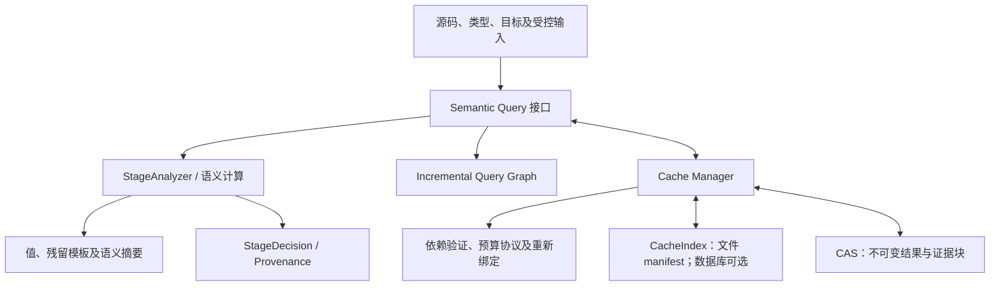

# Pagos Cache Architecture RFC

状态：C1a/C1b 协议与文件存储已实现，其余为提案。
探索基线为 `llvm` 分支 `5a01805`，提案日期为 2026-10-11，
C1a/C1b 完成日期为 2026-10-12。
本 RFC 承接 [Stage Evidence P0](stage-evidence-p0.md)，
安排在 P1 的有限 Comptime 理由扩展之前。
存储方案采用标准文件系统、内容寻址对象与专用二进制快照；数据库按实测
决定，不是既定依赖。具体实施顺序见[缓存实现迭代计划](cache-implementation-plan.md)。

目标是为语义结果复用、增量失效和证据存储确定共同协议，以 Stage 为首个
工作负载。本文不改变[阶段规范](staging-semantics.md)，也不表示已经具备
磁盘缓存、查询调度器、嵌入式数据库依赖或总编译器内存限制。

## 1. 需要分别解决的三个问题

| 问题 | 机制 | 成功指标 |
| --- | --- | --- |
| 再次编译重复求值 | 持久化语义结果 | 验证后跳过实际求值，端到端时间降低 |
| 输入修改后的重算范围 | 查询依赖记录与验证 | 复用未受影响的结果，正确失效受影响结果 |
| 证据和中间结果占用内存 | 摘要、分块、淘汰与按需加载 | 构建期及查询期峰值内存降低 |

统一存储设施可以支持三者，但完成其中一项不代表完成另两项。先构建整个
Provenance 图，再序列化到磁盘，不会降低首次编译的峰值内存。
磁盘缓存也不会自动把整模块 Analyzer 变成函数级或字段级增量分析器。

本提案优先缓存昂贵的计算结果与可重建的特化模板。默认 Comptime 解释使用
语义摘要；完整指令轨迹按需研究，不作为每个缓存项的必备内容。

## 2. 当前工程基线

| 现有组件 | 已有能力 | 跨会话复用的缺口 |
| --- | --- | --- |
| [StageAnalyzer](../include/pagos/stage/stage_analyzer.h) | 整模块分析、部分求值、会话内 memoization、只读 QueryContext | 独立查询边界、持久化接入、依赖协议 |
| [CacheIdentity](../include/pagos/stage/cache_identity.h) | C1a 定义身份、语义指纹及 SourceAnchor | 依赖验证、结果恢复及证据快照 |
| [FileStore](../include/pagos/cache/store.h) | C1b 文件 manifest、CAS、发布/校验及冲突标记 | Stage 准入、资源恢复、实际求值复用 |
| `specialization_cache_` | 全 Comptime 参数的纯常量结果 | 键含 AST 函数地址，结果含会话内 HIR |
| `residual_cache_` | 标量参数/结果的残留函数定义 | 符号、类型、参数与递归引用需要重建 |
| [StageDecision](../include/pagos/stage/provenance_analysis.h) | P0 规则、理由、成员与源码区间 | 当前条目稀疏，尚无完整纯求值理由 |
| [Builder/FrozenGraph](../include/pagos/stage/provenance_graph.h) | 追加构建、共享不可变快照 | 连续池常驻，ID 仅在所属图中有效 |
| [Constant](../include/pagos/value.h) | 带整数语义的负载；C1a scalar/array codec，C1b 字节存储 | 记录/指针格式、共享负载及求值复用 |
| [TargetLayout](../include/pagos/codegen/target.h) | 每会话目标布局及指针宽度 | 目标语义指纹与后端指纹的分工 |

[实现](../lib/stage/stage_analyzer.cpp)在 `analyze()` 开始时清空两个缓存。
调用先从左到右分析实参，再查缓存；未使用的实参仍保留残留工作。
`hir::is_cacheable_result` 排除携带残留工作等不适合复用的结果。
残留定义使用符号参数，当前调用重新绑定实际来源。

[构造预算](resource-budgets.md)按实际分析的构造计费：会话内命中不重建
函数体常量，因此不再次扣函数体构造配额；新实参构造在查询前扣费。
Fuel 与特化计数同样会受会话内 memoization 影响。持久化协议必须明确保存
这套基线，不能假设现有缓存已经对每次调用重复计入完整逻辑成本。

C1a 已建立独立 `pagos/cache` 协议层和 Stage 身份适配器，详见
[实现记录](cache-identity-c1a.md)。C1b 的文件存储、发布和错误边界见
[存储实现记录](cache-store-c1b.md)。本文查询调度、资源恢复、Stage 接入、
快照及 CLI 选项仍为设计；已有磁盘 Candidate 不代表已经跳过求值。

## 3. 必须保持的正确性约束

1. 对相同源码、目标、语义选项和限制，关闭持久化缓存、冷缓存、热缓存
   必须得到相同 Stage、已知值、残留行为和诊断。关闭模式保留现有会话内
   memoization；它是所有比较的参照实现。
2. 缓存命中不能穿透显式 Runtime 边界，不能从初始化常量恢复 Runtime 值。
3. 已知返回值、相同内容哈希或共享证据不允许删除、合并或重排不同调用的
   效果、陷阱、检查和控制工作。执行身份由当前 HIR/MIR 决定。
4. 查询必须记录全部影响结果的语义输入。缺失依赖、未声明外部输入、
   无法精确核算预算或无法重新绑定的位置使该查询不具备持久化资格。
5. 命中不能改变 `comptime` 契约、纯存储初始化检查及递归完成性的规则。
   证据查询的 `partial` 也不能被解释为新的 Stage 判断。
6. 删除、损坏或淘汰缓存只影响性能。缓存不是程序正确性所需的存储。
7. 会话内指针、NodeId、SummaryId、参数编号和 SourceSpan 不作为稳定身份。
   恢复后的诊断及解释必须对应当前源码与当前调用。

不追求每次运行的缓存遥测和内部节点编号一致；它们不能进入语义输出比较。
逻辑分析统计与物理求值、磁盘命中统计应分开报告。

## 4. 统一底座与两套图



| 图 | 回答的问题 | 边的含义 |
| --- | --- | --- |
| Stage Provenance Graph | 为什么结果是 Comptime/Runtime，留下什么工作？ | 数据、控制、契约、效果、初始化 |
| Incremental Query Graph | 哪些输入变化使某个查询结果不能复用？ | 源码定义、类型、查询结果、目标、受控输入 |

两套图共享稳定定义引用、对象存储和生命周期设施，不共享失效语义。
Incremental Query Graph 初期允许只是一份保守依赖清单，不必立即实现
完整调度器。递归查询需要单独的活动状态或 SCC 协议，不能假定所有查询
依赖天然无环。

例如 `first(7, external_input())` 返回已知 `7`，值解释可以不依赖第二个
参数；调用的残留工作仍依赖该实参。不能从值来源集合生成完整缓存依赖。
本地 `comptime` 契约、类型检查和未使用实参的求值也必须得到处理。

StageAnalyzer 保持语义决策权。Cache Manager 管理查找、验证、载入及淘汰，
不通过空来源集合猜测 Comptime，也不通过缓存证据增加分支收敛规则。

## 5. 最小查询与缓存单元

首个可持久化单元为：**已完成的纯函数特化结果**，参数全为带类型的
Comptime 值，结果为已解析的标量或固定长度数组。数组生成放在这样的函数
中形成独立查询；顶层直接生成器的独立查询提取留到后续。

```pagos
fn square(x: u32) -> u32 { x * x }
fn table() -> [u32; 256] {
    [for i in 0..256 { i * i }]
}
comptime let values = table();
let result = values[external_input()];
```

`square(7)` 与 `table()` 都是候选。命中 `table()` 后恢复 256 个元素，
仍为当前 `result` 构建 Runtime 索引与越界检查。
第一切片先排除包含其他普通函数调用、递归、记录/指针/全局引用、残留工作、
局部 Comptime 契约及无法重建的证据的函数体，以便预算与恢复可独立验证。
这些限制是原型准入条件，不是新增语言限制；不符合时走原 Analyzer。

| 后续查询种类 | 输入 | 输出 | 首次支持阶段 |
| --- | --- | --- | --- |
| `EvaluatePureSpecialization` | 定义、TypedStageArguments、语义环境 | 类型、常量、成本协议、解释摘要 | C1/C2 |
| `SpecializeResidual` | 定义、混合阶段参数、语义环境 | 符号残留定义、参数摘要及成本协议 | C3 |
| `AnalyzeValue` | 定义内的语义位置、输入知识 | Stage 与成员知识 | C4 |
| `AnalyzeResidualWork` | 语义位置及控制/效果环境 | 必须保留的工作模板 | C4 |
| `LoadEvidence` | 证据对象引用、当前源码和调用上下文 | 解释快照或明确的部分解释 | C3/C4 |

类型检查仍先运行；磁盘命中不跳过前端合法性检查。值查询与残留工作查询
可以有不同粒度，但关联结果必须来自同一套已验证输入，不能拼接不同修订的
常量与工作。首个原型不会缓存错误、未完成计算或整个模块。

## 6. 跨会话身份、键与指纹

### 6.1 稳定身份与源码位置

`StableDefinitionId` 拟由逻辑模块身份、定义路径和必要的同名消歧信息构成。
单文件阶段以显式工作区身份和工作区相对路径限定模块；不声称文件移动或
跨工作区共享自动命中。定义内容另有 `SemanticFingerprint`，用于判断修改。
同名函数改了内容，其身份可以保留，内容指纹必须变化。

语义指纹来自规范化的结构与已解析类型/引用，排除注释、空白、字节偏移、
AST 地址及容器遍历顺序。保留运算结构、定义和绑定关系、契约、声明属性、
名义类型及影响预算的语法结构。`1 + 1` 与 `2` 不因值相同而自动共享查询。

源码位置单独使用 `SourceAnchor`：稳定定义引用与定义内结构位置。
当前解析快照提供 Anchor 到 `source::Span` 的映射；该 Span 实际是字节
区间，不自带文件身份。恢复同时绑定当前文件和源码快照。纯空白修改可以
复用语义对象，但所有位置必须重映射；Anchor 缺失或歧义时重新计算。
原型若只能处理完全相同源码快照，必须将其明确记为限制，不能宣称支持
跨空白修改复用。

### 6.2 查找键与已验证依赖分开

```text
SemanticQueryKey = {
    query_kind, query_protocol_version,
    stable_definition_id, definition_semantic_fingerprint,
    typed_stage_arguments,
    semantic_options, target_semantic_key,
    compiler_compatibility_key, budget_protocol_version
}

CacheManifest = {
    canonical_query_key,
    ordered_dependencies: [(input_or_query_id, observed_fingerprint)],
    dependency_fingerprint,
    semantic_result_fingerprint,
    result_object, required_evidence_objects,
    optional_detail_objects, resource_recipe
}
```

键的哈希用于寻找候选 manifest；候选内仍保存规范键以核对相等。
`DependencyFingerprint` 是已记录依赖的摘要，**不是需要先知道完整依赖
才能查询的唯一索引键**。命中候选后逐项验证依赖，不以摘要代替输入读取。
内容哈希、查询键哈希、依赖摘要和语义结果指纹分别使用独立域标记。

原型保守使用整个已解析模块的语义指纹作为依赖，包含函数、记录、全局、
导入/导出边界及名称解析环境。这样无关定义变化也会失效，但不会漏掉
新增定义、声明属性或解析变化。后续才将它拆成实际观察的定义与类型查询。

原型的 `compiler_compatibility_key` 使用明确的编译器构建身份和编码版本，
避免手工语义版本漏更新；长期可分出语言语义、查询实现、预算协议、证据
格式及后端版本。跨 LLVM 版本复用只在目标语义提取也经过兼容性确认后开放。

### 6.3 TypedStageArguments

参数保持声明顺序，每个槽包含类型身份与以下知识之一：

- `Comptime(type, canonical_value)`：整数包含宽度、有符号性、`usize`
  身份和位模式；数组包含元素类型、长度、有序元素；记录包含稳定名义类型
  身份、字段模式指纹与声明顺序值，不能只用记录名称。
- `Runtime(type, constraints)`：保存槽位和确实影响特化的契约/知识，
  不保存“当前观察到的数值”或具体调用方的 HIR/来源 ID。
- 成员知识模式：未来若特化能消费混合聚合知识，必须逐成员规范编码。
  初期未定义该模式的聚合特化不进入持久化缓存。

```text
uart_divisor(Comptime(u32, 80000000), Comptime(u32, 115200))
uart_divisor(Comptime(u32, 80000000), Runtime(u32, boundary))
```

这两个输入必须分开。Runtime 来源只影响当前调用的来源绑定时，可以共享
符号残留模板；一旦来源或约束影响语义分析，就必须进入键或已验证依赖。
参数工作在查询前由调用方处理，不进入纯值键，也不存入可共享的函数体。

### 6.4 目标语义与后端条件

首个原型保守纳入解析后的完整目标配置及 DataLayout；host 默认值必须
先解析，不能以空 triple 作为可跨机器共享的目标。该方案牺牲跨目标命中率。

长期分为 `TargetSemanticKey` 和 `BackendKey`：前者记录实际影响类型、
整数语义、布局与边界合法性的目标条件；后者另含 CPU、features、优化选项、
ABI、LLVM/代码生成版本等。没有证明查询独立于某属性前不能排除它。
固定 `u32` 纯求值将来可能跨 CPU 复用；`usize`、指针、存储布局、ABI 与
volatile 合法性不能仅凭参数表面类型判断为目标无关。

## 7. 依赖验证与失效协议

每个查询通过受控读取记录语义依赖，命中时把已验证的依赖导入当前查询图，
否则下一轮将漏失效。实现最初采用“任一输入指纹变化就重算”的保守策略。
将来可在重算后比较语义结果指纹，实现变化输入但结果不变时的继续复用。

依赖应覆盖被调用定义、名义类型、名称解析、目标属性、语义选项及受控
输入。调用路径由 Comptime 条件选择时，记录条件与实际读取顺序；发现
决定路径的输入变化就停止沿用旧路径，重新运行查询，生成新的依赖列表。
Runtime 分支仍按当前分析规则覆盖两条分支。

| 修改 | 初期处理 | 将来可细化的结果 |
| --- | --- | --- |
| 注释、空白、行号 | 语义指纹不变，重映射位置 | 复用结果及正确的当前解释 |
| 函数运算、参数 Stage 或静态值 | 键或依赖变化，重算 | 重算相关特化 |
| 记录字段类型、顺序、身份 | 类型/模块依赖变化 | 失效相关值与布局查询 |
| Runtime 实参来源改变 | 当前调用重新分析 | 符号模板可复用，来源仍为当前实参 |
| RV32 改为 64 位目标 | 目标键变化 | 证明目标无关的固定宽度结果可复用 |
| 无关定义改变 | 模块依赖变化，保守重算 | 独立查询可以继续复用 |
| 预算降低 | 重新验证资源协议 | 成败与关闭缓存一致 |
| 外部输入变化/消失 | 受控输入指纹变化 | 失效读取该输入的查询 |

M5 的文件/环境访问必须经过能力接口：记录内容、路径解析、缺失状态以及
影响读取的声明环境，而非只检查 mtime。任意时间、随机性、网络或未声明
环境读取没有持久化资格。外部构建命令属于独立声明式 action executor，
不藏在普通 Comptime 求值中。M5 未实现前，缓存原型不添加这些能力。

## 8. 结果、残留工作与证据恢复

`CachedResult` 是独立、不可变的语义负载：解析后的类型、值或符号残留
模板、依赖引用、资源协议与必需解释摘要。不能序列化 C++ 对象布局、
shared_ptr、AST/HIR 地址、LLVM 指针或会话内参数 ID。

恢复协议按以下顺序执行：

1. 正常分析当前实参，检查类型，保留左到右求值和不继续执行的返回路径。
2. 优先查当前会话 memoization；未命中才查磁盘候选。
3. 验证键、兼容性、依赖、对象完整性、类型和值的一致性、位置与资源协议。
4. 在临时状态中恢复语义负载和必需证据；全部成功后才提交到当前会话。
5. 为当前调用建立新的参数、调用上下文、来源与执行身份，再组合实参工作。
6. 通过原有检查、HIR-to-MIR lowering 与 MIR 验证后才能交给 LLVM。

恢复失败时丢弃临时状态，走原 Analyzer；不能留下半个特化、重复扣费或
悬空引用。C3 首先恢复符号 HIR 模板，经现有 lowering 得到 MIR；若后续
直接保存残留 MIR，必须包含有类型的完整定义、符号引用和重编号协议，
重新验证 SSA、支配、控制与目标一致性。两者均使用 Pagos 自身编码，
不把 LLVM 的 Machine IR 格式当作 Pagos SSA MIR 的持久化格式。
递归组件必须整体完成并原子发布；
首轮残留持久化可以排除递归，不能保存活动定义占位符。

```pagos
fn first(a: u32, unused: u32) -> u32 { a }
comptime let result = first(7, external_input());
```

这个例子是必须保留工作的验收场景，不是 C2 的 Runtime 参数准入案例。
恢复值 `7` 不允许删掉读取。两次调用中的函数内部读取、volatile 写入、
外部调用与可能陷阱仍按各次调用区分，CAS 去重只共享定义与负载。
效果来源集合不是执行次数或顺序，不能用它替代残留模板。

`EvidenceSummary` 保留结果 Stage、已有决策规则/理由、符号参数与成员
关系、值与工作两类根，以及覆盖范围和可选详细块引用。恢复时将块内局部
编号重新映射为当前图 ID，重建符号摘要的参数作用域与调用上下文。
证据字段是独立协议，不能把未来的纯求值理由冒充已有 P0 枚举值。

C2 的默认路径仍由原 Recorder 记录恢复后的 HIR，且只接受能够重建当前
解释的纯子集；需要 P0 决策条目的结果在支持恢复之前拒绝持久化。
C3 将必需的精简证据与结果一起发布。它缺失或不兼容时重算语义查询，
保持当前 `explain-provenance` 能力；可选详细历史缺失时才允许报告详情
不可用或按需重放，不能把已有完整解释静默降为 `partial`。

这里的 proof-carrying cache 指“携带适用条件和解释依据的结果”。
正确性仍依赖可信编译器、准确的键、依赖协议和格式验证；内容校验或解释
摘要不能证明任意外部缓存的结果正确。本 RFC 只考虑本地缓存，远程信任与
认证另行设计。

## 9. 预算透明性：保持会话内基线

选择逻辑预算与**持久化缓存状态**无关。参照运行是没有磁盘复用、保留现有
会话内缓存的分析，而非把所有函数在每个调用点重新解释。

- 当前会话首次请求某个特化，即使磁盘命中，也计入参照运行需要的 Fuel、
  特化数量、相对调用深度及函数体构造配额。
- 同会话后续命中沿用已有 memoization 规则，不再扣函数体构造成本。
- 当前实参、生成器边界及外围表达式照常扣费；记录的函数体成本不能包含
  这些已经分析过的工作。
- 新残留定义按当前会话首次创建/预留规则计数，不能因磁盘已有定义而免计。
  读取磁盘、解压、解释 BFS 和宿主内存用独立物理预算管理。

已有 [函数体缓存用例](../tests/lit/stage/aggregate-budget-cache.pgs)中
`make()` 调用两次只计一次构造；
[新实参用例](../tests/lit/stage/aggregate-budget-cache-arguments.pgs)中
两个 `R(...)` 实参仍计两次。磁盘缓存必须保留这两种结果。

单个总成本数不足以解决嵌套特化：子查询可能已在当前会话命中，也可能
首次请求，需要不同成本；资源检查次序还决定首个错误及其位置。
因此 `ResourceRecipe` 拟记录有序逻辑资源事件与子查询引用，支持根据
当前会话的逻辑 memoization 状态核算，而不是直接重加以前的统计差值。
逻辑命中状态不得因宿主内存 LRU 淘汰而丢失；物理结果卸载后仍保留紧凑
逻辑记录，保证重新载入或计算不会改变配额。
将来恢复嵌套查询时，还必须按参照执行顺序提交子查询的逻辑命中状态及
可恢复结果引用，让后续调用得到相同的会话内复用；无法恢复这种状态时
拒绝父查询的持久化命中，不能只恢复父结果和一组总计数。

C2 先只支持无嵌套普通调用的封闭函数体。资源记录必须精确覆盖该子集的
Fuel 事件、进入深度、特化计数及构造保留操作；重复事件可压缩，但不能
改变逻辑顺序。数组先检查旧配额 `E4008`，再检查共享配额 `E4010`，保持
原有原子保留规则。预算协议版本单独参与兼容性检查。

命中先在状态副本中核算。若无法确认完全成功、遇到预算不足、位置无法
映射或活动特化冲突，则不提交任何成本/缓存项，退回原 Analyzer，从当前
尚未扣函数体成本的位置生成原有诊断与失败快照。初期只优化成功路径，
不重放失败诊断。资源记录不能精确支持的查询始终不持久化。

限制数值本身不能代替资源协议；即便写入键，相同限制下不同磁盘状态也
可能改变成败。降低 Fuel、递归、特化、数组和聚合配额都必须重新核算。
逻辑 `AnalysisStats` 应匹配参照运行，磁盘命中与实际求值步数另设遥测。

## 10. Hot/Cold 证据与内存生命周期

| 层级 | 内容 | 生命周期与缺失处理 |
| --- | --- | --- |
| Hot Evidence | 绑定 Stage、决策摘要、轻量来源/参数索引、覆盖标记 | 当前查询/快照需要时保留；必需摘要可重建 |
| Cold Evidence | 大型函数展开、生成器详情、可选历史证据块 | 按需加载，引用计数 pin 后才可淘汰 |
| 可重放详情 | 纯查询的详细计算解释 | 依赖和版本仍有效时重放，使用独立解释预算 |

Hot 是延迟目标，不代表每个编译历史的摘要永久驻留。应限制活跃工作集，
对常量负载、特化结果、证据块和查询临时空间分别计量与淘汰。
重放使用独立任务，不能改变已完成语义分析的预算或 Stage，也不能执行
Runtime 效果、未执行分支或未经声明的外部读取。

当前 `freeze()` 转移整张连续图并释放去重索引，冻结视图在快照存活期间
有效。不能在这个接口下偷偷卸载节点池，使已返回 span 悬空。
真正卸载需要新块句柄/读取 lease、块内 ID 与跨块引用协议，并保持 LSP
快照、源码快照和调用上下文的所有权一致。旧快照引用的块在读取时必须 pin。

C4 再研究构建期分块发布、释放已封闭详细区与有限摘要；仅在冻结后写磁盘
的方案不得声称降低构建峰值。先测量常量复制、特化键/结果、证据池、位置
与根表、旧 RuntimeTrace 和查询临时空间，判断收益来自哪里。
更大的构造配额或一个缓存容量选项都不构成总宿主内存保证。

## 11. 存储协议与工程恢复

### 11.1 文件系统与 CAS 是默认后端

标准文件系统管理发布与回收，CAS 保存不可变 Comptime 值、函数特化结果、
残留 HIR/MIR 及较大的 Provenance 快照。`CacheIndex` 初期用分片的文件
manifest 实现，保持可替换的查找/发布边界，不预先引入 SQLite 或 libmdbx。
查询键定位 manifest，内容哈希定位对象，两者不是同一种身份。

```text
.pagos-cache/
    queries/              # 查询键哈希 + 已验证输入指纹 -> 各代 manifest
    objects/
        1a/1a2f...        # 不可变值、模板或 provenance.snapshot 内容
        dc/dc01...        # 位置映射或可选详细块
    indexes/              # 后续可重建的批量查找/维护索引
    tmp/                  # 同文件系统的临时发布文件
```

文件按哈希前缀分片；`provenance.snapshot` 是负载种类及格式的示意名称，
实际 CAS 路径以哈希命名。对象大小不决定是否需要数据库；小文件压力先
测量，必要时评估批量索引或不可变 pack 文件，不立即实现在线合并系统。

CAS 对象头包含魔数、格式版本、种类、规范内容长度及内容摘要；使用明确
字节序、长度前缀和枚举标签，禁止 C++ 内存 dump。初期可采用 SHA-256
寻址，具体压缩方案在测量后确定。压缩策略可以改变对象字节和内容哈希，
不改变语义结果身份；manifest 明确关联对应的物理对象与语义指纹。

### 11.2 专用 Provenance 二进制快照

```text
provenance.snapshot
    Header                # 魔数、格式/兼容版本、语义指纹、Section directory
    Root section          # 绑定、契约、查询入口
    Summary section       # 函数摘要、参数槽与作用域
    Node section          # 定长 compact node records
    Edge section          # 定长 compact edge records
    Decision section      # 稀疏 StageDecision records
    Site section          # SourceAnchor，关联独立位置映射
    String section        # 名称与解释标签
    Import section        # 后续跨快照的符号摘要引用
    Chunk directory       # 后续块范围、codec、偏移、长度及校验
```

第一版以模块快照恢复当前 P0 图、绑定根和摘要为目标，使用未压缩的 section
和普通偏移读取。格式为可选 section 预留版本/能力信息，未实现的 Import
和压缩块不必填充。Section directory 保存种类、编码版本、偏移、字节长度、
记录数量与必要的记录宽度；检查范围、重叠、溢出及引用是否合法。

节点和边保留块内整数 ID，编码字段明确，不依赖 C++ struct 的 padding、
枚举宽度或 ABI。Root、Summary、Decision 及 Site 同样采用独立 wire
records；`StageDecision` 中的当前 Span 恢复时从 Anchor 映射生成。
稀疏决策可以用排序表查找；连续 NodeId 直接计算记录偏移，边按区间读取。
内容哈希验证对象字节，Semantic fingerprint 判断语义适用性，不互相替代。

源码位置映射单独作为对象，记录文件身份、源码快照指纹和 Anchor-to-Span
关系。查询 manifest 或当前源码快照关联它，语义图不将该对象哈希纳入自身
身份。空白修改可以继续复用语义图并重建位置映射；同一 Anchor 无法绑定
时重新分析。快照内标签如果来自原始文本，也需规范化或放入位置/展示对象。

模块快照之后再研究函数/特化单元。跨单元引用通过显式 Import 和根 manifest
绑定对象；递归组件先整体冻结，避免循环引用彼此的内容哈希。快照负责
解释产物，查询 manifest 仍负责依赖与资源验证，不能只凭 Header 的语义
指纹宣布缓存命中。

### 11.3 索引、偏移读取与 mmap

LLVM `OnDiskChainedHashTable` 可作为已冻结快照的可选查找索引，用于稳定
定义/绑定到摘要/Root 的映射。它提供生成与基于字节地址的读取接口，不是
可变的事务数据库，也不是通用按需 IO 回调。使用时由 Pagos 定义稳定 hash、
规范生成顺序、兼容版本与边界校验，保持 LLVM 类型不进入公共接口。
机制见 [LLVM OnDiskHashTable 源码](https://llvm.org/doxygen/OnDiskHashTable_8h_source.html)。

第一版无需依赖该索引即可读取整数 ID。后续比较排序表与 OnDiskHashTable，
只在入口查找有收益时加入。mmap 是未压缩 section 的可选读取优化，
映射寿命由只读句柄拥有；压缩 section 则经过有界块缓存和 lease。
不能在读取期间释放对应内存，也不能将压缩字节直接当节点数组使用。
分段目录只提供定位能力；构建期释放、局部验证与按需解压仍需独立协议。
第一版校验可以完整读取对象，后续再测量分块摘要及首次/重复读取的校验成本，
不能将一次整文件扫描隐藏在“按需读取”的性能声明里。

### 11.4 发布与回收

发布与回收规则：

1. 在同一文件系统写临时对象，检查长度及摘要，完整发布 CAS 对象后才发布
   manifest/提交索引。manifest 使用临时文件和原子发布；允许崩溃后丢失
   最近缓存，不允许读取半个发布结果。持久化 flush 策略另行测量。
2. 索引只引用已发布对象。崩溃可留下孤儿；缺失、截断、格式不兼容或摘要
   不匹配均视为未命中。索引损坏可以重建，不能成为语言错误。
3. 并发生成相同内容可以共享对象；同一已验证输入得到不同语义结果时报告
   内部确定性问题并停止该项复用，不能以最后写入者覆盖来掩盖差异。
4. 解码前限制对象大小、元素/节点数量、引用范围及解压输出。配额、OOM
   或 IO 失败应安全释放临时对象；格式校验不等于语义证明。
5. 磁盘容量淘汰先移除查询索引，再按仍可达对象回收。GC 与发布使用互斥
   维护窗口或显式 lease，读取者 pin 活跃对象；崩溃遗留 lease 可回收。
   无法保证的首轮原型不进行在线并发 GC。
6. 缓存不可写、目录被删除、磁盘满或锁超时均继续正常编译；可在独立缓存
   遥测记录原因。缓存关闭模式不读写磁盘，不能改动正常诊断输出。

将来提供明确的关闭、读写、只读和清理方式；选项名称与默认启用时机在
C2 实验后确定。缓存目录位置应显式可控且忽略于版本管理。原型清理行为
只作用于缓存目录，不包含源文件或用户生成物。

### 11.5 嵌入式数据库的启用条件

只有文件元数据开销、频繁反向依赖更新、多索引原子提交或共享缓存维护
已经形成实测瓶颈时，才评估数据库后端。索引可记录查询映射、依赖身份/
指纹、对象种类/长度与回收信息；大图仍留在 CAS，不逐节点/运算写数据库。
最近使用信息允许批量更新，避免每次命中都修改一个文件或事务。

libmdbx 是有序键值索引的候选；SQLite 是结构化元数据查询的候选。
libmdbx 使用 MVCC/CoW、内存映射及单写事务，长期读事务会阻止旧页回收，
见 [libmdbx 项目说明](https://github.com/Mithril-mine/libmdbx)。
SQLite WAL 也有单 writer 和 checkpoint 约束，见
[SQLite WAL 官方文档](https://sqlite.org/wal.html)。
实际体积、延迟、写入/回收成本与集成维护成本由 Pagos 工作负载比较，
不预设 libmdbx 一定更轻或更快，也不要求最终一定选用数据库。

若启用数据库，元数据读事务应短暂结束，LSP 的长期快照持有 CAS 读取句柄，
不持有数据库事务。数据库事务不能覆盖外部 CAS 文件，仍使用先对象后
索引的发布协议。首轮限定本机文件系统，数据库不可用、锁超时或索引损坏
均正常回退。数据库选型不作为 C3 或后续语义工作的完成条件。

## 12. 迭代计划与交付门槛

这里的 C1–C4 是 Cache 迭代，不与 Stage Evidence P0/P1 或 M3 准备编号混用。

| 迭代 | 交付 | 必须通过的门槛 |
| --- | --- | --- |
| C1：协议与独立编码 | 稳定身份、规范键、manifest、值/类型编码、资源准入 | 跨进程键稳定；Stage/目标/类型差异不错误命中；无需数据库 |
| C2：首个磁盘切片 | 纯叶函数与封闭数组生成函数的真实复用 | 跳过求值，三种缓存状态的语义及预算一致，恢复失败安全回退 |
| C3：快照与残留模板 | 模块二进制快照、符号摘要、非递归残留特化，沿用文件索引/CAS | 快照恢复等价；两次调用绑定自身来源/效果；MIR 验证通过 |
| C4：增量与按需证据 | 独立函数/字段查询、失效传播、块生命周期、受控输入接口 | 编辑失效正确；构建/查询内存有实测改善；快照与并发读取安全 |

协议设施已在 C1a 放入独立 `pagos/cache` 层，Stage 提供身份与 Anchor 适配器；
存储层不依赖 StageAnalyzer、LLVM IR 或业务语言效果判断。先以单查询
适配方式接到 `analyze_call` 的会话内 miss 路径，不立即重写整个 Analyzer。
基础公共 C++ API 已由 C1a 原型确定，C1b 增加文件存储接口；恢复 API
随后续迭代增加。
上述四个阶段拆成六轮可独立验证的实施工作：C1a 稳定键、C1b 文件存储、
C2a 纯标量、C2b 数组生成、C3a 模块快照、C3b 残留模板。
每轮的代码接入点、准入条件、正反例和交付门槛见
[实现迭代计划](cache-implementation-plan.md)。C4 根据前六轮结果另行拆分，
不把数据库、mmap 或压缩作为早期轮次的前置条件。

C2 首批用例为上面的 `square` 与 `table`，再加入多宽度数组和计算边界。
[cache-hits](../benchmarks/cache-hits.pgs)及
[specializations](../benchmarks/specializations.pgs)含嵌套调用，先作为
拒绝准入/基线测量场景；准确支持子查询资源协议后再纳入复用。
函数特化比顶层表达式更容易独立寻址，也能验证调用方工作不进入缓存负载。

## 13. 验证矩阵与测量方法

每个支持的查询都比较关闭持久化、空目录冷缓存、跨进程热缓存；再删除
缓存重跑。比较 Stage、常量、去掉缓存遥测的逻辑统计、HIR/MIR 语义结构、
诊断代码/顺序/当前位置/依赖路径及残留程序的执行结果。内部符号编号允许
规范化；不能把效果顺序差异规范化掉。

| 维度 | 正例 | 负例或失效案例 |
| --- | --- | --- |
| 键稳定性 | 不同进程、纯空白修改 | Stage、静态值、整数宽度/符号或 `usize` 身份改变 |
| 定义和类型 | 相同函数、声明顺序常量 | 被调用定义、记录字段顺序/类型或解析环境改变 |
| 目标 | 相同解析配置 | RV32/64、布局或边界合法性变化 |
| 资源 | 恰好满足全部配额 | 预热后降低 Fuel/深度/特化/数组/聚合限制，首错与冷跑一致 |
| 会话内 memoization | 两次 `make()` 一次构造 | 两个新实参构造均扣费；嵌套子查询已有/未有逻辑命中 |
| 参数工作 | 已知结果与 unused 参数读取 | 缓存预热后仍保留读取、检查、早返回和左到右顺序 |
| 证据 | 当前实参、当前调用及重映射位置 | 不得继承首次调用来源；缺必需摘要重算，缺可选详情明确标记 |
| 存储 | 规范 round-trip、重复发布 | 截断、校验失败、未知版本、非法引用、超大解码、索引损坏 |
| 生命周期 | 销毁 Analyzer 后查询快照 | 淘汰/GC 与读取交错、并发同键发布、发布各阶段崩溃 |
| M5 输入 | 相同声明文件内容 | 文件变化/缺失、环境变化、未声明能力读取 |

C1/C2 以 GoogleTest 覆盖规范键、编码与资源协议，以 lit/FileCheck 覆盖
CLI 和失败路径。当前未支持的类别应测试正常回退；C3/C4 才启用对应
持久化验收，不能把所有正例都不准入当作缓存实现完成。

性能报告单独记录前端、求值、依赖验证、编码、IO、恢复、MIR/后端时间，
实际跳过的求值、会话内/磁盘命中率、未命中原因、对象大小、工作集及峰值
RSS。用独立进程和相同目标/限制对比三种模式，区分 Pagos 冷缓存与操作
系统页缓存；记录源码/二进制哈希、机器、工具链、全部样本和波动。
不以“保存并读取了 JSON”作为性能成功，也不把独立图原型结果当整编译提速。

沿用 [benchmark 工具](../scripts/benchmark.py)的可复现记录方式，后续增加
缓存模式与编辑序列。先保证正确性，再判断小函数序列化成本和大型数组收益，
不在缺少实测时宣称数据库、mmap、压缩或磁盘卸载一定降低时间或内存。

## 14. 决策与仍待实验的问题

本 RFC 建议确定：统一缓存协议、独立两套图、稳定语义身份与源码位置分离、
Stage 进入键、值与工作独立恢复、预算对持久化状态透明，以及先纯结果后
残留模板/证据的迭代顺序。默认存储为文件系统 + CAS + 专用二进制快照；
可替换数据库索引只在明确瓶颈后评估，文件系统可以成为长期方案。

仍需 C1/C2 实验回答：规范编码和资源记录的实际大小/成本、最小准入范围、
源码 Anchor 重映射策略、何时替换整模块指纹、目标属性如何安全缩减，
以及是否存在值得持久化的小函数。C3/C4 再确定跨块 lease API、压缩与
淘汰策略、递归组件协议、结果指纹继续复用及 LSP 快照容量。
远程缓存、全编译器数据库、后端对象缓存、完整 VM 历史和 What-if 求解
不属于首轮范围。

## 15. 参考设计

本文把已有系统的机制作为参考，Pagos 的 Stage、效果、预算和恢复规则
仍由自身协议确定，不直接照搬其他编译器的可缓存范围。

- [Rust 编译器的增量查询设计](https://rustc-dev-guide.rust-lang.org/queries/incremental-compilation-in-detail.html)：
  稳定定义身份、结果指纹、依赖验证，以及命中后向新图转入旧依赖。
- [Bazel 缓存模型](https://bazel.build/remote/caching)：action 结果索引与
  内容寻址输出分离；对应本文索引和不可变负载的职责划分。
- [LLVM OnDiskHashTable](https://llvm.org/doxygen/OnDiskHashTable_8h_source.html)：
  不可变快照内的可选入口索引，不承担事务与在线更新。
- [libmdbx](https://github.com/Mithril-mine/libmdbx)：可选的事务键值元数据
  后端，以及单 writer、长期读事务的生命周期约束。
- [SQLite WAL](https://sqlite.org/wal.html)：本机读写并行、单 writer 与
  checkpoint 限制；对应后续短事务和锁竞争回退策略。
- [Stage Model RFC](stage-model-rfc.md)、
  [Provenance analysis](provenance-analysis.md)与
  [资源预算](resource-budgets.md)：本设计必须保持的 Pagos 语义基线。
